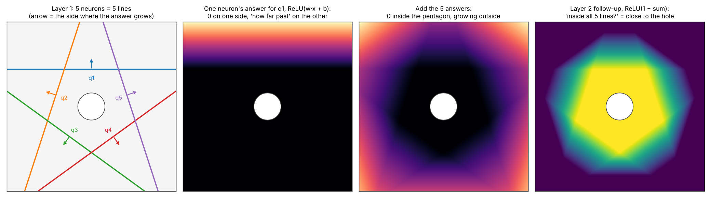

# Structure of a neural network: neurons as questions

Notes on the intuition behind the shape of a neural network: what one hidden neuron does, what width and depth mean, and how the same idea explains channels and CNN filters. They came out of a long conversation with Claude while studying physics models (Transolver, FNO, GNS) and apply directly to the MLP in [`neural_networks.ipynb`](neural_networks.ipynb).

## My summary

> Very nice talking to Claude about the intuition behind the NN. Each node in the hidden layer means **one question asked using all the features**. For example, for a house with 10 features, each node takes all 10 features together, one weight per feature, and asks one question about them: "is this a large, pricey family home?" With 32 nodes in the hidden layer, you are basically asking 32 questions about each house, each one using all of its features.
>
> Channels are the answers to those questions at each index. A (31, 20) array means there were 31 things (houses) that are indexed by only one number, house 1, house 2, …, and we have 20 answers for each of them. For pixels in a picture, though, we cannot identify points by only one index ("point 1" is not very clear), so we say point (2, 3), its row and column. That point then has three "features", or channels if you want to call them that: R, G and B. So the filter (the hidden layer for a picture) is 3 × 3 × 3 × 64: it asks 64 questions, and each question looks at the whole 3 × 3 neighbourhood across all the colours (27 numbers) at once and merges them into one answer.

Two small corrections went into this version. A node is *one* question that mixes all 10 features, not 10 questions. And a CNN filter doesn't ask a question per colour and merge afterwards: each of the 64 questions already uses all 27 numbers together.

The sections below fill in the details.

## 1. One neuron = one question

A hidden neuron takes every input feature and computes one number:

$$a = w_1 x_1 + w_2 x_2 + \dots + w_d x_d + b$$

For a house, the 10 weights say how much each feature counts towards the question. "Is it a pricey family home?" might be $0.8\cdot\text{size} + 0.5\cdot\text{bedrooms} - 0.3\cdot\text{age} + \dots$

Geometrically, $a = 0$ is a line (2 inputs), a plane (3 inputs) or a hyperplane (more), and $a$ measures how far the point is past it. The activation turns that into an answer:

* **Sigmoid** (what this repo's network uses): a soft yes/no, about 0 on one side of the line and about 1 on the other.
* **ReLU / GELU** (most modern networks): a hinge, 0 on one side and "how far past the line" on the other.

So the answers are graded, not strictly yes or no. A neuron says "how much", and later layers can use that.



The figure shows this on a plate with a hole (made by [`figures/make_structure_figures.py`](figures/make_structure_figures.py)). Each of five layer-1 neurons draws one line and answers "how far am I past my line, away from the hole?" Adding the five hinges gives a bowl that is 0 inside the pentagon. A layer-2 neuron then asks a follow-up question about those answers, "is the total still small?", and that is a "close to the hole" detector. No single line could draw that shape.

## 2. Width and depth

* **Width** is the number of questions a layer asks at once. A hidden layer of 32 asks 32 questions about each input.
* **Depth** is asking follow-up questions about the answers. Layer 1 asks "close to the hole?", and layer 2 can ask "close to the hole *and* near an edge?"

Adding hinges together builds bumps, ridges and steps, so with enough of them a layer can draw almost any shape, not just a tilted plane. A useful picture: **width is the resolution of the shapes a layer can draw, depth is how many times you can compose those shapes.**

**Why 32?** The width is just how many hinges are available.

* With too few, say 4, the features are coarse and the model can't represent sharp things, like a steep temperature drop near a hole.
* With too many, say 512, each step is slower, the model can memorize the training data more easily, and the extra benefit is small.
* In between, 22, 32 and 52 would often work about the same. 32 is a hand-picked hyperparameter. Powers of two are a habit (with a small hardware benefit), and people try a few values and keep one that is good enough. Nothing derives it from the problem.

This repo has a direct example. In [section 3 of the notebook](neural_networks.ipynb), the sinusoid data is separable with 2 → **4** → 2 (0.2% validation error), but 2 → 2 → 2 (18.1%) and 2 → 2 → 2 → 2 (19.8%) fail. Two questions per layer aren't enough to unfold the data, and adding a second narrow layer doesn't make up for it.

## 3. Common layer shapes

* **Funnel (wide → narrow):** classic classifiers, like this repo's MNIST network, 784 → 128 → 64 → 10. Ask many basic questions, condense the answers into fewer high-level ones, and end with one score per class.
* **Constant width:** the middle of transformers, Transolver, FNO and GNS. Every block keeps the same number of channels per point, because each block refines the same representation and a residual connection adds its update back. The width is the size of the "notebook" each point carries, and depth keeps rewriting it.
* **Expand, then contract inside a block:** the MLP in a transformer block goes, for example, 16 → 64 → 16 (usually 4×). It briefly asks many questions, then summarizes them back into the notebook.

So in modern models the follow-up questions aren't fewer. They're about as many, but more abstract, and the narrowing happens only at the very end. CNNs for images are slightly different: the grid gets smaller while the channel count grows, so there are fewer places but more questions at each place.

## 4. Channels are the question axis

The axes of a tensor play different roles:

| Tensor | Axes |
|---|---|
| (20, 32) for 20 houses | *which house*, *which question* |
| (28, 28, 64) for one image | *which row*, *which column*, *which question* |
| (N, 16) for one plate of N points | *which point*, *which question* |

**"Channel" is the name for the *which question* axis when it sits next to "where" axes** like rows, columns or points, so you can say "64 answers at each location". In the house case nothing says "where", only "which house", so people call the 32 "hidden units" or "features". It's the same thing under a different name. So a channel is a hidden neuron. The only difference is how many places the neuron gets asked at.

* At the input, the channels are the raw facts at each location: R, G, B for a pixel, or x, y and distance-to-hole for a point on a plate.
* In a hidden layer, 32 channels means 32 learned questions asked at every location, like "is there an edge here?" or "am I near the hole?" Every layer adds its own learned "colours".

Watch out for the word "width". **W** in H × W × C is the *image* width, the number of pixel columns. That's space, not neurons. "Layer width" is the number of neurons, which is **C**.

An image stored as H × W × 3 and as N × 3 (N = H·W) holds the same numbers. The grid layout only adds **who is next to whom**. A CNN filter needs it to find the 3×3 neighbourhood. If you flatten to N × 3, you have to put that information back some other way: add x and y as features (positional encoding), add edges (GNS), or let attention work it out (Transolver, vision transformers).

## 5. A CNN is the house MLP at every pixel

1. Stand at one pixel and take its 3 × 3 neighbourhood × 3 colours: **27 numbers**. Treat that as one "mini-house" with 27 features.
2. A layer with 64 filters is a weight matrix of **27 × 64**, stored as 3 × 3 × 3 × 64. That's 64 questions, each using all 27 numbers together, colours and neighbours mixed. You get 64 answers for that pixel.
3. Slide to the next pixel and ask the **same 64 questions with the same weights**. A 28 × 28 image gives 784 mini-houses, so the output is 784 × 64, reshaped to 28 × 28 × 64.

| | Items | Features per item | Layer | Output |
|---|---|---|---|---|
| Houses | 20 houses | 10 | 10 × 32 | 20 × 32 |
| CNN, one image | 784 mini-houses | 27 | 27 × 64 | 784 × 64 → 28 × 28 × 64 |
| CNN, 20 images | 20 × 784 | 27 | 27 × 64 | 20 × 28 × 28 × 64 |

The next 3 × 3 layer treats each pixel's 3 × 3 × 64 = 576 numbers as a new mini-house and asks its own follow-up questions.

**Stride and padding.** For input size $n$, kernel $k$, stride $s$ and padding $p$ on each side, the output size is

$$\left\lfloor \frac{n + 2p - k}{s} \right\rfloor + 1$$

With stride 2 on a 28 × 28 image: padding 1 ("same" padding) gives $\lfloor (28 + 2 - 3)/2 \rfloor + 1 = 14$, so 14 × 14 × 64. With no padding it's $\lfloor (28 - 3)/2 \rfloor + 1 = 13$, so 13 × 13 × 64.

## 6. Batches vs. the points of one item

Items in a batch never see each other. Twenty houses are twenty separate problems, and so are twenty images.

The N points of one physics item, such as the temperature field on one plate, are different. The answer at one point depends on the others, because heat flows across the plate, so the N points form *one* item. That's why the shape is (B, N, C) and not (B·N, C). In models like Transolver, the per-point MLPs still treat each point on its own, like a mini-house. Points only "talk" in a mixing step (slice attention in Transolver, message passing in GNS, Fourier modes in FNO, the 3 × 3 window in a CNN).

So MLP, CNN, GNS, FNO and Transolver all ask questions the same way. They differ only in how a point is allowed to see other points when it answers.

## Try it

[`shapes_demo.py`](shapes_demo.py) checks every shape on this page with NumPy. It also builds the CNN layer as a (784, 27) @ (27, 64) matrix product and confirms it matches a pixel-by-pixel loop.

```bash
python shapes_demo.py
```
