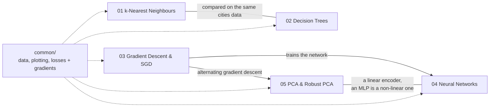

# Machine Learning From Scratch

Implementations of core machine learning algorithms written with NumPy instead of high-level libraries: k-nearest neighbours, decision trees, gradient descent and SGD, a neural network with hand-written backpropagation, and PCA / robust PCA.

Each model has its own numbered folder with the code, a notebook that runs it on real data and explains the results, and a README with the key ideas and how it connects to the other models. Shared helpers (data loading, plotting, loss functions with analytic gradients) are in [`common/`](common).

## Map



## Models

| # | Model | What's implemented | Result | Notebook |
|---|---|---|---|---|
| 01 | [k-Nearest Neighbours](01-k-nearest-neighbours/) | Vectorized pairwise distances, k-NN classifier, 10-fold cross-validation written by hand | 6.5% test error on US cities, vs. 16.1% for a depth-5 decision tree | [knn.ipynb](01-k-nearest-neighbours/knn.ipynb) |
| 02 | [Decision Trees](02-decision-trees/) | Equality, error-rate and information-gain splitting rules; recursive tree | Training error matches scikit-learn's entropy tree at every depth | [decision_trees.ipynb](02-decision-trees/decision_trees.ipynb) |
| 03 | [Gradient Descent & SGD](03-gradient-descent/) | Gradient descent, Armijo line search, mini-batch SGD, four learning-rate schedules | Shows why a constant step never converges and why $c/t^2$ stops too early | [sgd.ipynb](03-gradient-descent/sgd.ipynb) |
| 04 | [Neural Networks](04-neural-networks/) | Multi-layer perceptron with sigmoid layers, softmax loss, backpropagation, L2 regularization; notes on [the structure of a neural network](04-neural-networks/structure-of-a-neural-network.md) | ~95% validation accuracy on MNIST; visualizes how hidden layers make non-linear data separable | [neural_networks.ipynb](04-neural-networks/neural_networks.ipynb) |
| 05 | [PCA & Robust PCA](05-pca/) | PCA via SVD; L1 robust PCA via alternating gradient descent | 2-D map of 50 animals from 85 traits; separates moving cars from the background in traffic video | [pca.ipynb](05-pca/pca.ipynb) |

## Repository layout

```
common/
  utils.py                  data loading, distances, plotting
  fun_obj.py                loss functions with analytic gradients, incl. neural-net backprop
01-k-nearest-neighbours/    knn.py
02-decision-trees/          decision_stump.py, decision_tree.py
03-gradient-descent/        optimizers.py, learning_rate_getters.py, linear_models.py
04-neural-networks/         neural_net.py, layers.py, structure-of-a-neural-network.md
05-pca/                     encoders.py (PCA, gradient-based robust PCA)
data/                       datasets used in the notebooks (pickled NumPy arrays)
```

Every folder also has a README and a notebook. The notebooks put `common/` and the folders they need on the Python path in their first cell, so they run from their own folder or on Colab.

## Running it

Open a notebook on Colab with the badge at its top, or run it locally:

```bash
pip install -r requirements.txt
jupyter notebook 04-neural-networks/neural_networks.ipynb
```

Each notebook runs in under two minutes on a CPU; the neural network one takes the longest because of MNIST. scikit-learn is used only to one-hot encode labels and as a reference to check the decision tree.

## Acknowledgements

These projects come from coursework in UBC's CPSC 340 (Machine Learning and Data Mining). The course provided the datasets and parts of the supporting framework (for example plotting helpers and the line-search optimizer). I implemented the algorithms themselves.
